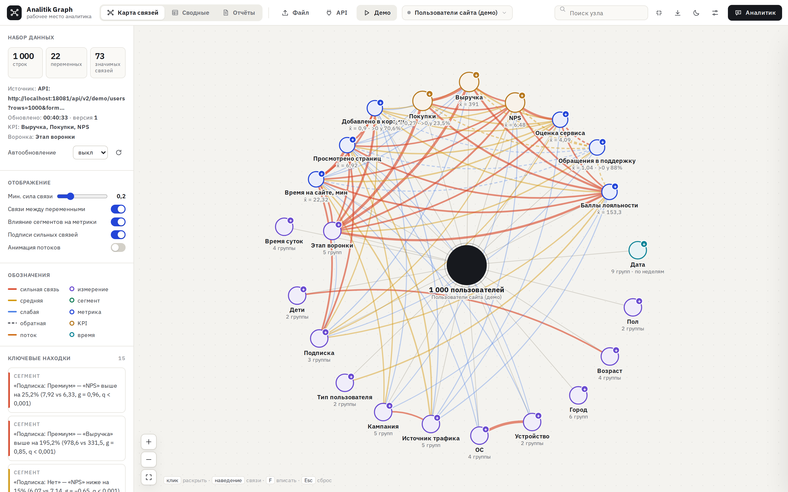
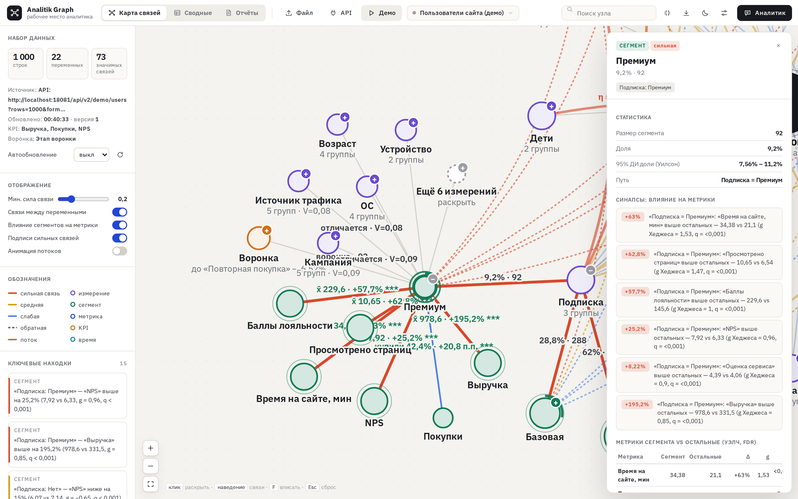
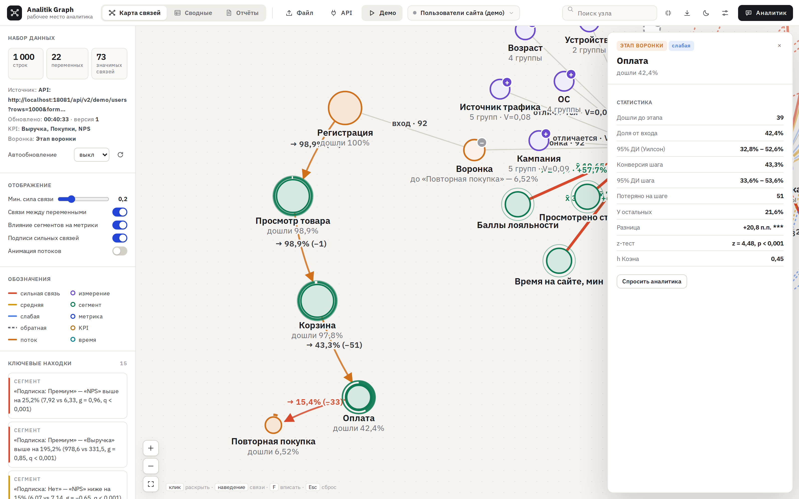
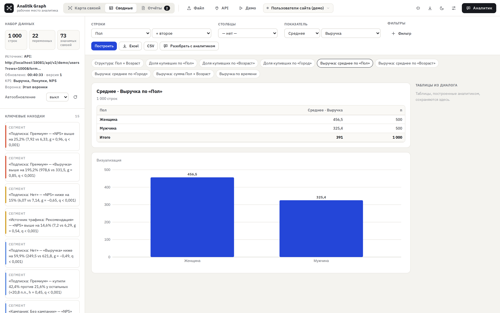
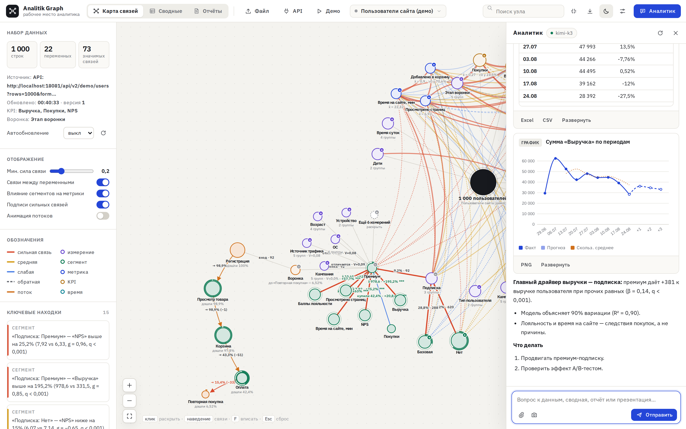
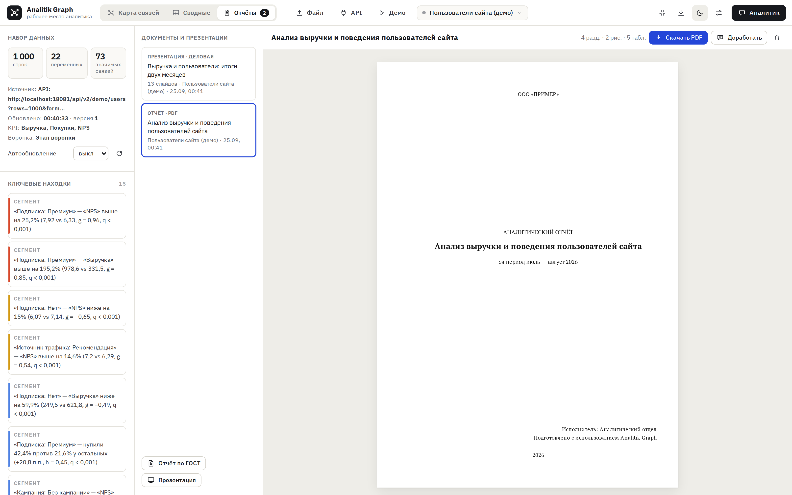
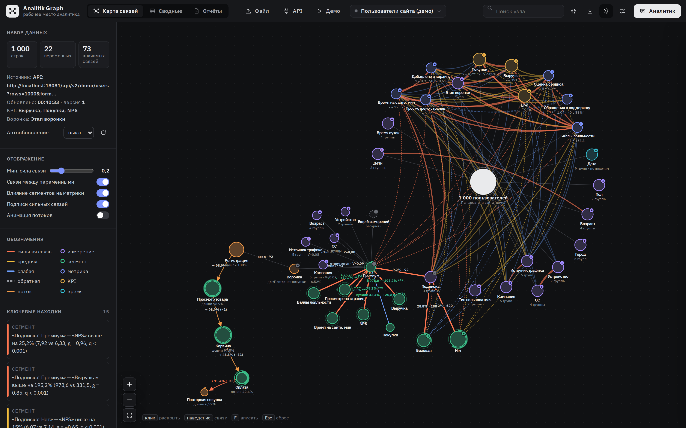
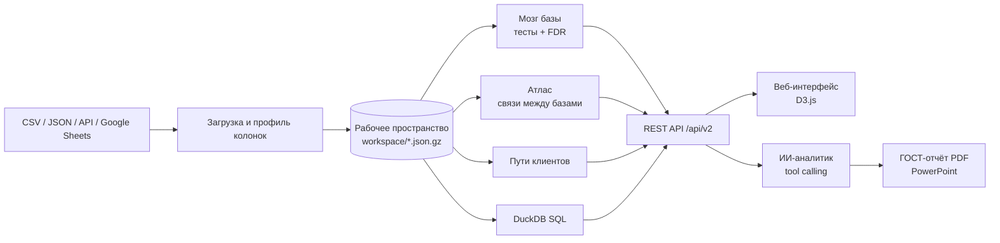

<div align="center">

# Analitik Graph

**Рабочее место аналитика: данные компании в виде карты причин и следствий**

Загрузите таблицу или подключите API. Система сама найдёт статистически значимые зависимости, разложит аудиторию на сегменты и покажет, как клиенты ходят по продукту. ИИ-аналитик соберёт сводные, отчёт по ГОСТ и презентацию на реальных цифрах.




</div>

---

## Что умеет

| | |
|---|---|
| 🧠 **Мозг базы** | Граф «что на что влияет» внутри таблицы. Узлы — колонки, рёбра — только статистически значимые связи (Спирмен, χ², ANOVA) после поправки на множественные сравнения. Клик по узлу раскрывает ветку: сегменты с 95% ДИ, KPI сегмента против остальных, воронка. |
| 🗺 **Атлас** | Несколько баз на одном графе. Ключи между таблицами находятся автоматически, связи *между* базами считаются на уровне клиента без раздувания сумм (fan trap / chasm trap). |
| 🛤 **Пути клиентов** | Граф переходов по событиям: доля клиентов на шаге, процент выхода, влияние шага на цель (z-тест долей + FDR), профиль людей на любом переходе. |
| 🧹 **Сортировка сырых данных** | Плоский «грязный» лог → чистка (числа «1 290,00 ₽», даты, варианты написания, дубли) → функциональные зависимости → связанные таблицы. Производные таблицы пересчитываются сами при изменении источника. |
| 🗄 **SQL-консоль** | Встроенная DuckDB по всем таблицам: JOIN, оконные функции, сохранение результата как новой таблицы на графе. Режим только для чтения, доступ к файлам и сети из SQL выключен. |
| 📊 **Сводные и анализы** | Конструктор сводных, ABC/Парето, драйверы (многофакторная регрессия с отсевом утечек), тренд с прогнозом, аномалии (MAD / 3×IQR), юнит-экономика (ARPU, ARPPU, Джини), аудит качества данных. Экспорт в Excel/CSV. |
| ✦ **ИИ-аналитик** | Модель не считает «из головы»: она вызывает инструменты сервера (сводные, тесты, графики, формулы). Понимает скриншоты и фото таблиц. Работает с любым OpenAI-совместимым провайдером. |
| 📄 **Отчёты и презентации** | Отчёт по ГОСТ 7.32-2017 в PDF (титульный лист, реферат, содержание, нумерованные рисунки). Презентации: 6 тем, 14 макетов, экспорт в PowerPoint с редактируемыми графиками. |

## Скриншоты

<table>
  <tr>
    <td width="50%"><br><sub><b>Ветка графа</b>: сегменты и их влияние на KPI</sub></td>
    <td width="50%"><br><sub><b>Воронка</b> по этапам и сегментам</sub></td>
  </tr>
  <tr>
    <td><br><sub><b>Сводные</b> без ИИ, с экспортом в Excel</sub></td>
    <td><br><sub><b>ИИ-аналитик</b> отвечает с реальными цифрами</sub></td>
  </tr>
  <tr>
    <td><br><sub><b>Отчёты</b> и презентации</sub></td>
    <td><br><sub><b>Тёмная тема</b></sub></td>
  </tr>
</table>

🎬 Демо-видео: [presentation-media/graph-demo.mp4](presentation-media/graph-demo.mp4)

## Быстрый старт

Нужны **Java 11+** (рекомендуется 21) и **Maven**.

```bash
git clone https://github.com/Sena22555/analitik-graph.git
cd analitik-graph
bash start.command
```

Скрипт найдёт Java, при необходимости соберёт проект и откроет http://localhost:8080. На macOS можно просто дважды кликнуть по `start.command`.

Вручную:

```bash
cd analytics-graph-engine
mvn spring-boot:run
```

Затем нажмите **«Демо»**: появятся 4 связанные базы (пользователи, события на сайте, платежи, поддержка) с заложенными эффектами, которые граф находит сам.

## Настройка ИИ-аналитика (необязательно)

Граф, SQL, сводные и анализы работают без ИИ. Для ассистента нужен ключ любого OpenAI-совместимого провайдера (`/chat/completions`, `/models`).

**Вариант 1.** Кнопка ⚙ в интерфейсе.

**Вариант 2.** Переменные окружения:

```bash
export AI_BASE_URL=https://api.openai.com/v1
export AI_API_KEY=your-key
export AI_MODEL=gpt-4o-mini
```

**Вариант 3.** Файл в корне проекта:

```bash
cp analitik-ai.properties.example analitik-ai.properties
```

> 🔒 `analitik-ai.properties` и папка `workspace/` (там сохраняются заголовки API-источников) уже в `.gitignore`. Ключ хранится только на сервере и в браузер не уходит.

## Статистика под капотом

Ничего не показывается «на глаз»: каждая связь на графе проходит тест и поправку на множественные сравнения.

- **Связи:** Спирмен (+ ДИ Фишера), χ² + V Крамера (поправка Бергсмы), ANOVA + η²/ω², Краскел–Уоллис
- **Сравнение сегментов:** t-тест Уэлча + g Хеджеса, z-тест долей + h Коэна, интервалы Уилсона
- **Контроль ложных открытий:** Бенджамини–Хохберг, показываются только связи с q < 0,05
- **Распределения:** Жарк–Бера, выбросы по Тьюки, гистограммы Фридмана–Диакониса
- **Модели:** МНК-регрессия с проверкой коэффициентов, отсев утечек и коллинеарности

## Архитектура



```
analitik-graph/
├── analytics-graph-engine/          # Spring Boot приложение
│   ├── src/main/java/com/analytics/
│   │   └── brain/                   # ядро
│   │       ├── data/                # загрузка CSV/JSON/API, типы и профили колонок
│   │       ├── mathematics/         # статистические тесты
│   │       ├── analysis/            # ABC, драйверы, тренд, аномалии, финансы, качество
│   │       ├── service/             # граф, атлас, пути, SQL, хранилище
│   │       ├── structure/           # авто-разбор сырого лога на таблицы
│   │       ├── formula/             # интерпретатор формул для вычисляемых колонок
│   │       ├── query/               # сводные и графики
│   │       ├── ai/                  # клиент LLM, инструменты ассистента
│   │       └── api/                 # REST-контроллеры
│   ├── src/main/resources/static/   # фронтенд: граф, сводные, SQL, отчёты, презентации
│   └── документация/                # доклады по ООП и классам (PDF), презентация
├── presentation-media/              # скриншоты и демо-видео
├── start.command                    # запуск в один клик
├── USAGE.md                         # подробное руководство и REST API
└── ROADMAP.md                       # дорожная карта
```

Подробная карта классов ядра: [brain/README.md](analytics-graph-engine/src/main/java/com/analytics/brain/README.md).

## REST API

Основные эндпоинты (полный список в [USAGE.md](USAGE.md)):

| Метод | Путь | Что делает |
|---|---|---|
| `POST` | `/api/v2/datasets` | создать базу: `{name, csv}` / `{name, data:[...]}` / `{name, url, headers}` |
| `GET` | `/api/v2/datasets/{id}/overview` | граф: узлы, связи, инсайты |
| `POST` | `/api/v2/datasets/{id}/analysis/{type}` | `drivers`, `abc`, `trend`, `finance`, `quality`, `anomalies`, `funnel`… |
| `GET` | `/api/v2/workspace/graph` | атлас всех баз |
| `POST` | `/api/v2/journey` | граф путей клиентов |
| `POST` | `/api/v2/sql/query` | SQL по всем таблицам |
| `POST` | `/api/v2/ai/chat` | чат с ИИ-аналитиком (SSE) |

```bash
curl -X POST http://localhost:8080/api/v2/datasets \
  -H 'Content-Type: application/json' \
  -d '{"name":"Продажи","csv":"city,revenue\nМосква,1200\nКазань,800"}'
```

## Безопасность

- Сервер слушает только `127.0.0.1` и не виден в локальной сети.
- CORS разрешён только для `localhost`.
- При смене адреса ИИ-провайдера без нового ключа сохранённый ключ сбрасывается, поэтому его нельзя «увести» на чужой сервер.
- SQL-консоль работает только на чтение, без доступа к файловой системе и сети.

## Стек

**Backend:** Java, Spring Boot, Apache Commons Math, Apache Commons CSV, DuckDB, Jackson, Caffeine  
**Frontend:** vanilla JS, D3.js, PptxGenJS, pdfmake, SheetJS, marked

---

<div align="center">
<sub>Автор: <a href="https://github.com/Sena22555">Arsenij Sadovskij</a></sub>
</div>
